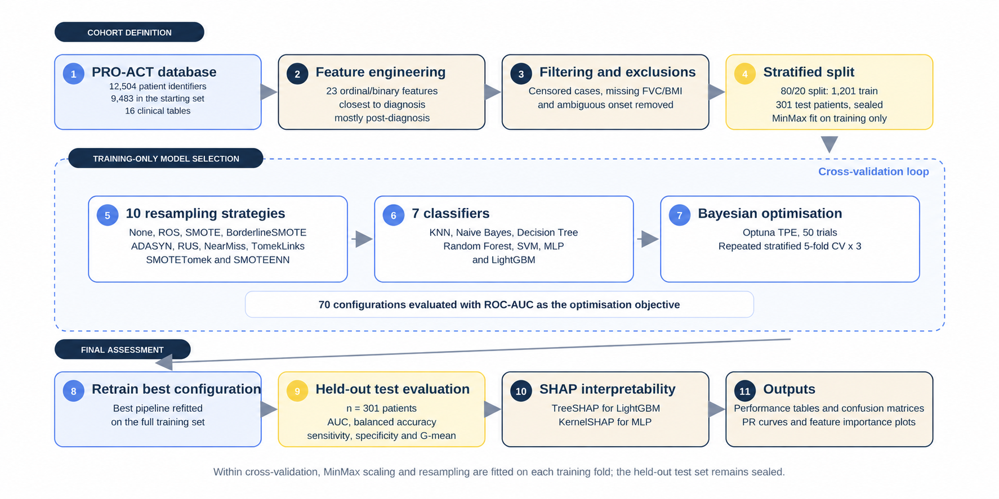
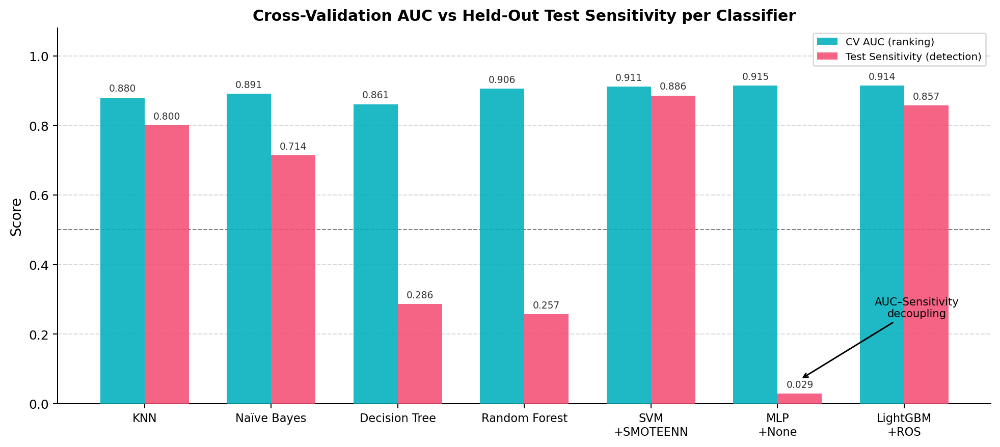
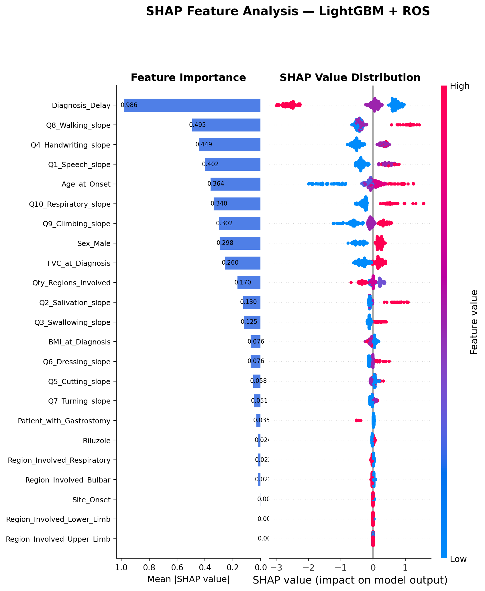
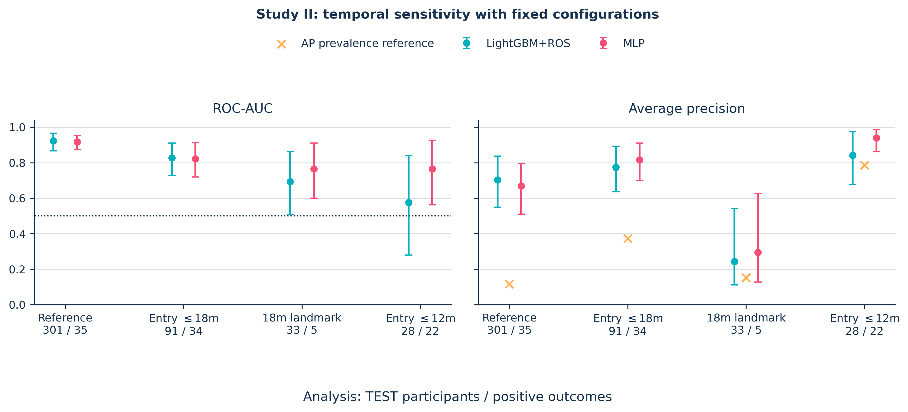

# ALS Survival Prognosis and Class Imbalance

The study partially replicates and extends the framework of [Papaiz et al. (2024)](https://doi.org/10.1186/s12911-024-02484-5) for identifying patients who die within 24 months of symptom onset. It compares imbalance strategies, tests BalancedBagging, and examines why high ROC-AUC can coexist with very low sensitivity at the default threshold.



## Study design

| Component | Definition |
|---|---|
| Outcome | Short Survival: death within 24 months of symptom onset |
| Primary cohort | 1,502 complete-case patients, including 174 Short Survivors |
| Outcome-eligible cohort before complete-case filtering | 5,802 patients |
| Predictors | 23 ordinal and binary clinical features |
| Classifiers | KNN, Naive Bayes, Decision Tree, Random Forest, SVM, MLP, LightGBM |
| Imbalance conditions | None, ROS, SMOTE, BorderlineSMOTE, ADASYN, RUS, NearMiss, TomekLinks, SMOTETomek, SMOTEENN |
| Model search | 70 classifier-condition combinations, 50 Optuna trials per combination |
| Selection metric | Mean ROC-AUC across stratified five-fold CV repeated three times |
| Patient split | 1,201 training patients and 301 held-out test patients |
| Preprocessing | MinMax fitted after the split and separately within each CV training fold |
| Ensemble comparison | Single classifier versus BalancedBagging for all seven families |

Resampling operates on training observations only. Validation and test observations retain their original class distributions. Test predictions are not used to select hyperparameters, configurations or thresholds.

### Timing of the clinical records

The closest-record rule uses absolute distance from the recorded diagnosis date, so it can select a later measurement. In the primary cohort, more than 99% of the selected ALSFRS, FVC and weight records occurred after diagnosis; their median offsets were approximately ten months. The study is therefore retrospective classification using available trial records. It does not establish prediction performance at the diagnosis encounter, and the 24-month outcome is anchored at symptom onset rather than diagnosis.

## Reported results

These are the dissertation's held-out results, not estimates from a new repository run.

| Model and operating point | ROC-AUC | Sensitivity | Specificity | Short Survivors detected |
|---|---:|---:|---:|---:|
| LightGBM + ROS, default threshold | 0.923 | 0.857 | 0.831 | 30/35 |
| MLP, default threshold | 0.918 | 0.029 | 1.000 | 1/35 |
| MLP, development-selected sensitivity threshold | 0.918 | 0.771 | 0.883 | 27/35 |

LightGBM's ROC-AUC had a 95% confidence interval of [0.868, 0.966]. The MLP ranked patients well but placed almost all test scores below 0.50. Its sensitivity-constrained threshold, 0.078, was selected from out-of-fold training predictions and then applied unchanged to the test set. The development sensitivity target of at least 0.90 did not transfer exactly to held-out patients.



BalancedBagging improved cross-validated balanced accuracy for six of the seven classifiers. Four of the five directly comparable model families reproduced the reference study's qualitative improvement, with Naive Bayes as the exception. Random Forest and LightGBM are extensions of this common BalancedBagging comparison, not exact replications of the reference ensembles.

TreeSHAP for LightGBM and KernelSHAP for MLP both ranked diagnostic delay first. Several ALSFRS item slopes also contributed substantially. Diagnostic delay and the survival outcome share symptom onset as their temporal anchor, which limits a purely clinical interpretation of the attribution.



## Repository layout

```text
01_data/
  raw/               Authorised PRO-ACT tables, stored locally
  interim/           Reconstructed feature and outcome tables
  processed/         Coded data, train/test partitions and local arrays
02_scripts/          Numbered analysis and figure-generation scripts
03_outputs/          Published search summaries/configurations; other outputs stay local
assets/              Selected published figures used in this README
requirements.txt     Python dependencies
```

The original dissertation stores these scripts under `replication/`. This standalone repository places that study at the root; the script-relative data paths retain the same relationships.

## Installation

Use Python 3.12 (verified locally with 3.12.10). From the repository root:

```bash
python -m venv .venv
# Windows PowerShell: .venv\Scripts\Activate.ps1
# Linux/macOS: source .venv/bin/activate
python -m pip install --upgrade pip
python -m pip install -r requirements.txt
```

The original analysis environment was not frozen as a historical lock. Core dependencies in `requirements.txt` are pinned to the Python 3.12.10 environment inspected on 23 October 2026; its complete installed-package inventory is in `requirements-verified.txt`. This is also the environment used for the supplementary fixed-configuration bagging discrimination check. It does not establish the exact environment at the time of every original run, or guarantee identical numerical estimates across platforms. Retain the original data extract, row order, partition definitions, and seeds when checking reproduction.

## Primary analysis

Obtain authorised access from [PRO-ACT](https://ncri1.partners.org/proact), place the original `PROACT_*.csv` tables in `01_data/raw/`, and run:

```bash
python 02_scripts/step1_data_loading_exploration.py
python 02_scripts/step2_preprocessing.py
python 02_scripts/step3_cleaning_filtering.py
python 02_scripts/step3_temporal_audit.py
python 02_scripts/step4_train_test_split.py
python 02_scripts/step5_modeling.py
python 02_scripts/step6_test_evaluation.py
```

Step 4 saves both unscaled and training-scaled partitions. Step 5 uses unscaled training observations to fit MinMax within each CV fold. Step 6 fits the selected configurations on the training partition and saves held-out probabilities locally for the subsequent threshold and uncertainty analyses.

The model search is computationally expensive. `N_TRIALS`, `CLASSIFIERS` and `IMBALANCE_TECHNIQUES` in `step5_modeling.py` control its scope. The script resumes completed combinations from its local results file; retain those files only when intentionally continuing the same experiment.

## Thresholds, uncertainty and ensemble replication

After the primary analysis:

```bash
python 02_scripts/step11_threshold_analysis.py
python 02_scripts/step12_bootstrap_ci.py
python 02_scripts/step7c_bonferroni.py
```

Threshold analysis obtains probabilities from repeated CV within training data, with MinMax fitted within each fold. It compares the default threshold, Youden's J, the highest threshold achieving at least 0.90 OOF sensitivity, and the minority-class F1 optimum. All selected thresholds are subsequently evaluated on the saved held-out probabilities.

Bootstrap analysis estimates percentile intervals from 2,000 test-set resamples. The BalancedBagging comparison uses paired fold results and Wilcoxon tests with Bonferroni correction across classifier families. Overlapping CV training sets limit the independence of those statistical comparisons.

## Explainability and figures

```bash
python 02_scripts/step7_shap_analysis.py
python 02_scripts/step7b_paper_figures.py
python 02_scripts/step8_figures_paper.py
python 02_scripts/step9_figures_paper2.py
python 02_scripts/step10_workflow_figure.py
```

Some figure scripts also write copies to a generated `overleaf/figures/` directory. No LaTeX project is needed. The horizontal pipeline in `assets/` is the dissertation's updated explanatory figure; Step 10 generates a separate schematic.

## Missing-data sensitivity analysis

```bash
python 02_scripts/step11_missing_data_sensitivity.py
```

This separate post-hoc analysis retains the 5,802 outcome-eligible patients, uses a new stratified split, and compares median imputation with five stochastic iterative imputations using the selected LightGBM+ROS hyperparameters. Imputation, scaling and oversampling are fitted on training data only. Its test patients differ from those in the complete-case analysis, so the estimates are descriptive rather than paired comparisons. This script does not replace or re-optimise the primary cohort.

## Reviewer follow-up checks

After the primary analysis, run these supplementary checks from the repository root:

```bash
python 02_scripts/reviewer_followup.py
python 02_scripts/step13_bagging_discrimination.py
```

The first script validates the local Step 6 probability export against the saved
test labels, confusion matrices and ROC-AUCs before computing average precision,
Brier scores, reliability plots and descriptive calibration diagnostics. It also
compares complete and incomplete cases, audits the onset-to-trial reference time
by outcome, checks unrecognised onset text, and compares LightGBM/SVM sensitivity
using paired test predictions. It uses 2,000 bootstrap resamples by default and
does not refit models or recalibrate probabilities. Optional `--project-root`,
`--probabilities`, `--output` and `--bootstrap` arguments are available. Assertions
check the original study cohort, not an arbitrary new data extract.

Step 13 repeats the original 15 development folds with the saved no-resampling
hyperparameters, comparing single classifiers with ten-estimator BalancedBagging.
It reports both ROC-AUC and balanced accuracy, records convergence warnings and
does not silently replace a failed fit with a score. It uses no test observations
and performs no new Optuna search. Outputs from both commands remain local in
`03_outputs/reviewer_followup/`. The supplementary balanced-accuracy means matched
all 14 original single/bagging means to numerical precision in the inspected runtime.

The timing audit found that 756 of 1,328 Standard Survival participants had a
source-trial reference time at or beyond 24 months after symptom onset. That
reference is an entry-time proxy, not a verified individual enrolment date. The
primary results remain a retrospective replication reference, not a diagnosis-time
prediction model. BalancedBagging gains at the default operating point should
not be read as uniformly improved ranking, and oversampled-model probabilities
are not calibrated clinical risks. The reference ensembles also used ten selected
configurations, rather than ten bags of one configuration as here.

The selected configurations in `03_outputs/step5/step5_best_configs.json` and the
aggregate 70-combination `step5_cv_results.csv` are included. They contain no
patient records and allow the fixed-parameter checks to reuse the original
choices without running Optuna again. Original authorised data, unscaled
partitions and split assignments remain necessary. Do not overwrite these
reference configurations with new search results when reproducing the checks.

### Temporal and encoding sensitivity

After retaining the original unscaled partitions and selected configurations, run:

```bash
python 02_scripts/reviewer_temporal_evaluation.py
python 02_scripts/plot_temporal_sensitivity.py
python 02_scripts/test_supplementary_revision.py
```

The temporal evaluator calls `reviewer_temporal_cohorts.py` to reconstruct the
supplementary cohorts. It keeps the original train/test membership and order,
seven classifier/resampling configurations, and hyperparameters. Scaling and
resampling remain training-fold estimates. Thresholds use pooled predictions
from the 15 development folds; TEST is not used to select them. No new Optuna
search is performed. The test script uses synthetic fixtures, not a study rerun.

Entry-only restrictions retain the original retrospective predictors, whereas
landmark tasks include observed survivors and restrict dated measurements,
height and riluzole to the prediction time. A positive landmark outcome is death
after that time and by month 24. Static demographic/onset history is assumed
available rather than independently time-stamped. BMI uses conventional
left-closed boundaries in the landmark tasks; an isolated BMI-boundary check on
the original cohort changes two codes without changing the displayed LightGBM
or MLP ranking scores or native confusion matrices.

| Analysis | Total N | TEST N / events | LightGBM ROC-AUC | MLP ROC-AUC |
| --- | ---: | ---: | ---: | ---: |
| Original reference | 1,502 | 301 / 35 | 0.923 | 0.918 |
| Entry proxy at/before 18 months | 424 | 91 / 34 | 0.828 | 0.823 |
| Dated 18-month landmark | 161 | 33 / 5 | 0.693 | 0.764 |
| Entry proxy at/before 12 months | 124 | 28 / 22 | 0.576 | 0.765 |

The changes are not a causal estimate of left-truncation bias: populations,
prevalences and fitted models differ, and landmarking changes the prediction
question. Five test events make the 18-month landmark estimates imprecise.
The 12-month landmark retains only 41 complete cases and cannot support the
predeclared five-fold design. KNN+RUS also fails in the 12-month entry cohort
because k=31 exceeds 22 observations after resampling. Neither case receives
a fallback score or post-hoc retuning. Across feasible tasks, 27 configurations
complete 432 fits; the final entry-18-month MLP fit has a recorded convergence
warning under the retained iteration limit.

Aggregate metrics, fold scores, warnings and failure/status records are written
to `03_outputs/reviewer_followup/revised_analyses/`. Reconstructed patient tables
and predictions remain in ignored `01_data/interim/reviewer_revision/`.
Unknown onset text now stays missing instead of silently becoming limb/spinal;
the current extract had no records taking that old fallback. Missing dated
riluzole means no recorded timely use, not confirmed absence of treatment.

Selected aggregate results and the thesis timing figure are published below.
The plotting command reads the aggregate CSVs produced by the evaluator when
available, or the published JSON otherwise. The original reference intervals
come from the validated saved probability audit, not a new model fit.



[Aggregate results](assets/reviewer_followup/results.json)

Saved historical trial means cannot establish whether any individual Study II
fold used the original AUC-0.5 failure fallback; a historical fold-level failure
ledger was not available. Current dependency pins and new checks do not reconstruct
that missing historical record.
The revised Step 5 records failures, successful fold metrics and trial exports,
then stops on errors instead of assigning AUC 0.5. Original searches were not
repeated. No reliable source-trial ID was reconstructed, and no delayed-entry
survival model, trial-level validation or clean-environment reproduction is claimed.

## Data use and limitations

PRO-ACT combines de-identified records from completed clinical trials. This study is secondary analysis with no new recruitment or clinical data collection. Data access remains subject to the platform's [terms and conditions](https://ncri1.partners.org/ProACT/Document/DisplayLatest/1).

The repository distributes code and selected published figures. It excludes original data, patient-level derived tables, train/test arrays, individual predictions, SHAP matrices and fitted models. The code licence does not authorise redistribution of PRO-ACT records.

Complete-case selection, the timing of the trial assessments, the onset-based target and the small minority-class test sample constrain generalisation. These models require an explicit prediction time, independent external validation and prospective assessment before clinical use.

The reference framework is Papaiz et al., *Ensemble-imbalance-based classification for amyotrophic lateral sclerosis prognostic prediction: identifying short-survival patients at diagnosis*, BMC Medical Informatics and Decision Making 24, 80 (2024), [doi:10.1186/s12911-024-02484-5](https://doi.org/10.1186/s12911-024-02484-5).

The companion functional-progression study is in [explainable-als-progression](https://github.com/Applied-Intelligence-Hub/explainable-als-progression). This repository retains the GNU GPL v3 [licence](LICENSE) supplied by Applied Intelligence Hub.
